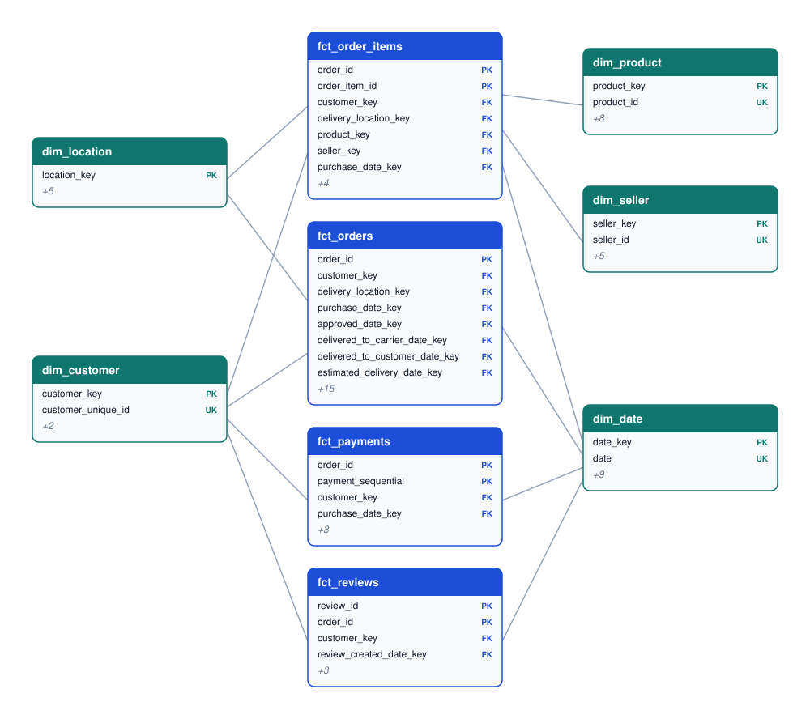
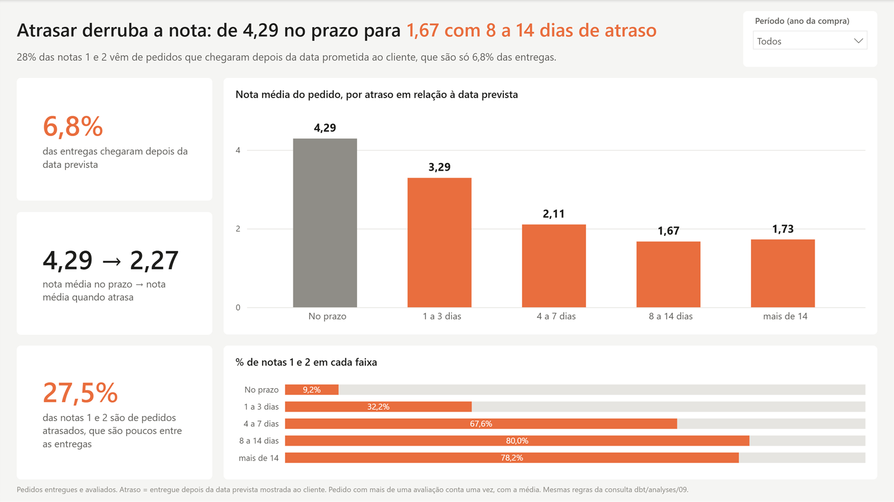

# Olist data modeling

[](https://github.com/JoseEnriq/olist-data-modeling/actions/workflows/build.yml)

**English** | [Português](README.pt-BR.md)

I built a local analytics database for the public Olist e-commerce dataset: dbt loads nine raw CSV files into DuckDB, tests them and models them into a star schema that answers business questions in a few lines of SQL. The focus is the reasoning behind each modeling decision, written down with the alternatives I rejected.

## The problem

Raw data from an order system looks easy to query, but it is full of traps. Here, `customer_id` changes with every order, so counting it hides repeat buyers; one review can cover several orders; a zip code has many coordinates, some of them outside Brazil; and joining payments to items silently multiplies the amounts. Queried directly, the data gives wrong numbers with no error message.

## Data

[Brazilian E-Commerce Public Dataset by Olist](https://www.kaggle.com/datasets/olistbr/brazilian-ecommerce), licensed CC BY-NC-SA 4.0: about 99 thousand orders placed between 2016 and 2018. The files are not in the repository; `scripts/download_data.py` fetches them. Category names, cities and statuses stay in Portuguese, as in the source.

## How it is built

```
data/raw/*.csv ──► staging (stg_*) ──► intermediate (int_*) ──► marts (dim_*, fct_*)
                   types and names     shared steps             what people query
```

Every layer is a set of tables in one [DuckDB](https://duckdb.org/) file, an analytical database that runs without a server and reads the CSVs directly; [dbt](https://www.getdbt.com/) builds and tests them. Staging only types and renames; joins and aggregations happen later, so every number can be traced back to a source row. Python scripts download the data, check the marts against the source and export the reports. On every pull request, GitHub Actions rebuilds the database from scratch, runs all tests and fails if the committed reports are out of date.

Each step was designed in [docs/](docs/), built in its own branch and merged through a pull request.

## The model

I designed it twice. The [normalized model](model/normalized.md) shows how the source data relates in third normal form. The [star schema](model/dimensional.md) reorganizes it for analysis, with four facts at different grains so nothing is counted twice:

| Fact | One row is |
|---|---|
| `fct_order_items` | a unit of product sold |
| `fct_orders` | an order, with a date for every milestone (accumulating snapshot) |
| `fct_payments` | a payment |
| `fct_reviews` | a review linked to an order |

They share five dimensions: date, customer, delivery location, product and seller.



## Key decisions

All 35 are in [docs/decisions.md](docs/decisions.md). The ones that mattered most:

- **The customer is `customer_unique_id`.** 96,096 people hide behind 99,441 `customer_id` values; the address belongs to the order, since 250 customers bought with more than one zip code.
- **Totals are summed per order before joining**, and reconciliation tests prove the marts keep every row and every BRL of the source.
- **"Delivered" means having a delivery date**, not the status: 8 orders are `delivered` without one.
- **A correction I made along the way:** I first assumed the median per zip code would ignore points outside Brazil. Building the model showed 8 prefixes still out of the country, so those points are now dropped before the median.

## What the data shows

From [docs/results.md](docs/results.md), generated by `scripts/export_results.py`; no number here is typed by hand.

- **Late deliveries destroy the rating:** orders delivered on time average 4.29 stars; 8 to 14 days late, 1.67, with 80% of reviews at 1 or 2 stars.
- **Delivery time depends on the region:** the median is 7.2 days in São Paulo and 25.9 in Amazonas.
- **Customers rarely come back:** 97% of them bought only once.
- **Credit card dominates:** 74% of payments, with 3.5 installments on average.

## The dashboard

The star schema also feeds a Power BI report built around one question: where is logistics costing reviews? It is saved as PBIP, so every measure and visual is reviewable text in [powerbi/](powerbi/); the measures repeat the definitions of the SQL analyses, and the numbers match `docs/results.md`. Pages, model choices and how to open it are in [docs/dashboard.md](docs/dashboard.md).



## What I left out

The project covers modeling and transformation on a local database. Ingestion from live sources, incremental loads, orchestration and the cloud are outside its scope.

## Reproduce it

Requires Python 3.12. From the repository root:

```bash
python -m venv .venv && source .venv/Scripts/activate   # on Linux/macOS: .venv/bin/activate
pip install -r requirements.txt
python scripts/download_data.py
cd dbt && dbt deps && dbt build && cd ..
python scripts/validate_marts.py && python scripts/export_results.py
python scripts/export_marts.py   # Parquet files for the Power BI report
```

`dbt build` creates 19 models and runs 117 tests (one expected warning: geolocation points outside Brazil). The reports land in `docs/validation.md` and `docs/results.md`. To open the dashboard, open `powerbi/olist.pbip` in Power BI Desktop and point the `MartsFolder` parameter to your `data/marts` folder.
