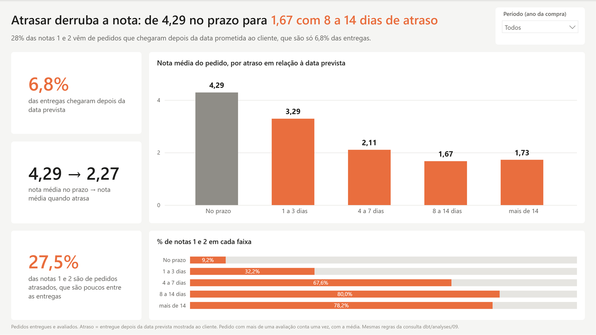
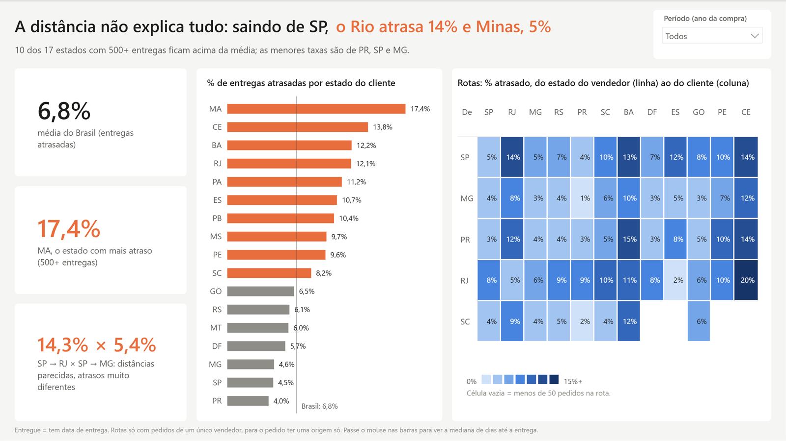
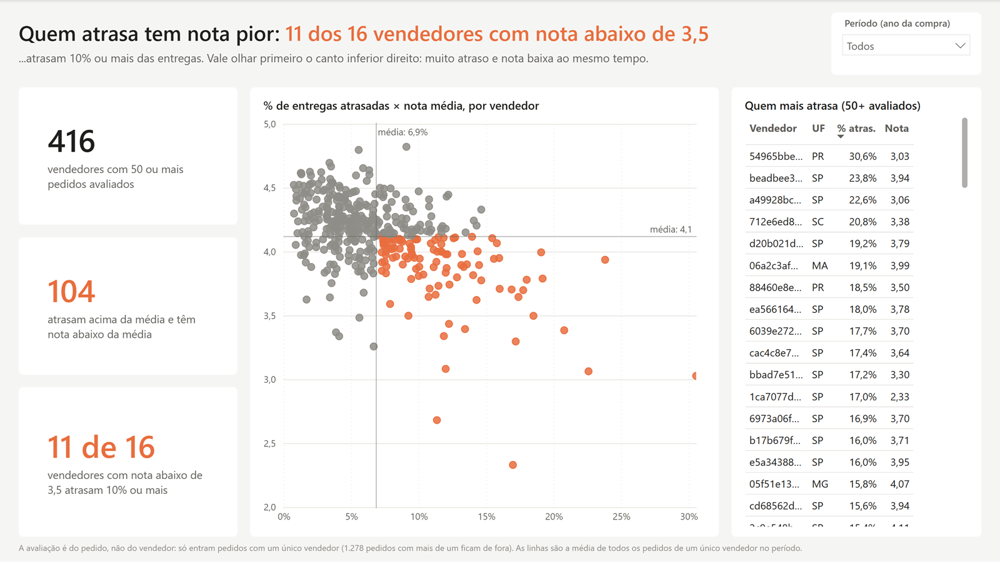
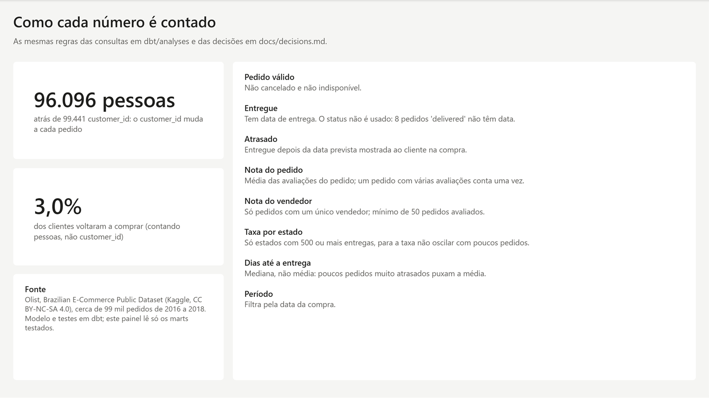

# Painel: onde a logística está custando avaliações?

O painel em [powerbi/](../powerbi/) consome o star schema dos marts sem nenhuma tabela feita só para ele. A ideia é mostrar que o modelo testado serve um BI de verdade: as medidas repetem as definições das consultas em [dbt/analyses/](../dbt/analyses/), e os números batem com [results.md](results.md).

Ele foi pensado para um gerente de operações e responde a uma pergunta só, em quatro páginas. Os prints abaixo mostram o período inteiro (2016 a 2018). Nas três primeiras páginas há um filtro de ano da compra, e os títulos mudam junto com ele, porque também são medidas.

## As páginas

**1. O efeito.** A nota média cai a cada faixa de atraso, e a maior parte das notas 1 e 2 dos pedidos atrasados é de quem esperou mais de 4 dias.

**2. Onde.** Mostra o % de entregas atrasadas por estado do cliente, só para estados com 500 ou mais entregas, e uma matriz de rotas, do estado do vendedor ao do cliente. A matriz mostra que a distância não explica tudo: saindo de SP, o Rio atrasa muito mais que Minas.

**3. Quem.** Cada ponto é um vendedor com 50 ou mais pedidos avaliados. Em laranja aparecem os que atrasam acima da média e têm nota abaixo dela. A tabela ao lado lista quem mais atrasa.

**4. Como cada número é contado.** Reúne as definições usadas e duas armadilhas que o modelo evita.

## Como o modelo do Power BI usa os marts

- **Formato PBIP.** O modelo fica em TMDL (`olist.SemanticModel/`) e as páginas em PBIR (`olist.Report/`), tudo em texto, então cada medida e cada visual aparece no diff de um PR. O `.pbix` binário não seria revisável.
- **Fonte.** O `scripts/export_marts.py` exporta os 9 marts para Parquet em `data/marts/`, fora do Git. O Power BI lê esses arquivos sem driver; para ler o `.duckdb`, ele precisaria de ODBC e de um conector personalizado.
- **As mesmas 9 tabelas do star schema.**
  - `fct_orders` funciona como cabeçalho do pedido: itens, pagamentos e avaliações se ligam a ele por `order_id`, e as dimensões filtram o pedido.
  - Assim não existem caminhos ambíguos, e a nota pode ser filtrada pela faixa de atraso do pedido.
- **`dim_date` com papéis.** A data da compra é a relação ativa. As datas de entrega e de avaliação ficam inativas, para usar com `USERELATIONSHIP`.
- **Avaliação atribuída ao vendedor só quando o pedido tem um vendedor**, como na consulta 08.
  - A coluna `single_seller_key` tem uma relação inativa até `dim_seller`, ligada só nas medidas "(um vendedor)".
  - Ficam de fora 1.278 pedidos com mais de um vendedor.
- **Nota do pedido calculada uma vez.**
  - `order_score` é a média das avaliações do pedido, como coluna.
  - Na primeira versão, essa média era recalculada pedido a pedido em cada filtro, e uma das medidas de vendedor levava 47 segundos; agora leva menos de 1.
- **Duas armadilhas do DAX.**
  - Um valor vazio passa em `= FALSE()` e em `<= 2`.
  - Por isso, "no prazo" exige `is_delivered`, e "nota baixa" exige nota preenchida.

## Medidas × consultas

| No painel | Mesma regra de | Valor no painel = results.md |
|---|---|---|
| Nota média por faixa de atraso, % de notas 1 e 2 | [09](../dbt/analyses/09_review_score_vs_delay.sql) | 4,29 no prazo, 1,67 com 8 a 14 dias de atraso |
| Dias até a entrega (mediana) por estado | [05](../dbt/analyses/05_delivery_time_by_state.sql) | 7,2 em SP, 25,9 no AM |
| % de entregas atrasadas por estado (500+ entregas) | [06](../dbt/analyses/06_late_deliveries_by_state.sql) | MA com 17,4% |
| Nota e % de notas baixas por vendedor (50+ avaliados) | [08](../dbt/analyses/08_seller_ratings.sql) | melhor 4,82, pior 2,33 |
| Clientes que voltaram a comprar | [10](../dbt/analyses/10_repeat_customers.sql) | 3,0% (96,96% com um pedido) |

A comparação foi feita com consultas DAX no modelo aberto no Desktop, contra o `results.md` gerado pelo `scripts/export_results.py`.

## Como abrir

1. Rode o pipeline do README e depois `python scripts/export_marts.py`, que cria os 9 Parquet em `data/marts/`.
2. Abra `powerbi/olist.pbip` no Power BI Desktop, que é grátis.
3. Em *Transformar dados > Editar parâmetros*, aponte `MartsFolder` para a sua pasta `data\marts` e clique em *Atualizar*.

O valor versionado do parâmetro é um exemplo (`C:\olist-data-modeling\data\marts`). Para não commitar o caminho do seu computador, use `git update-index --skip-worktree powerbi/olist.SemanticModel/definition/expressions.tmdl`.

## O que o painel não faz

- **Não está publicado.** Publicar na web exige uma licença paga do Power BI Service. Por isso o repositório mostra os prints, e o painel interativo fica para quem abre o `.pbip`.
- **Não tem o mapa de vendas** que costuma abrir painéis da Olist. A pergunta aqui é de operação: onde e por quem o atraso acontece.
- **O filtro de período usa a data da compra.** Um pedido comprado em dezembro e entregue em janeiro conta no ano da compra.
