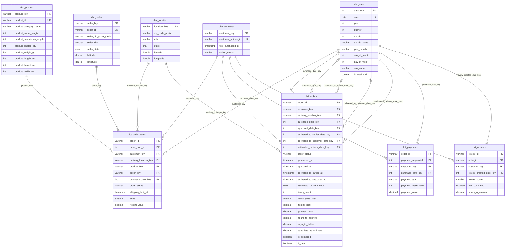

# Modelo dimensional (star schema)

Gerado por `scripts/render_diagrams.py` a partir de [dimensional.dbml](dimensional.dbml). Não edite à mão: altere o `.dbml` e rode o script de novo.

Legenda: `PK` chave primária, `FK` chave estrangeira, `UK` valor único. `||--o{` = um para zero ou muitos; `|o--o{` = a chave estrangeira pode ser nula.

## Tabelas

| tabela | descrição |
|---|---|
| `dim_date` | Um dia por linha, de 2016-01-01 a 2018-12-31. Usada em vários papéis: compra, aprovação, envio, entrega, entrega prevista, avaliação. |
| `dim_customer` | Uma linha por pessoa. O endereço não fica aqui: ele muda de pedido para pedido (ver dim_location). |
| `dim_location` | Endereço de entrega como foi informado no pedido. Uma linha por combinação de prefixo, cidade e estado, porque o mesmo prefixo aparece com estados diferentes. |
| `dim_product` |  |
| `dim_seller` | O vendedor tem um endereço só, então a localização fica achatada na própria dimensão. |
| `fct_order_items` | Fato transacional. Grão: uma unidade de produto vendida num pedido. |
| `fct_orders` | Accumulating snapshot. Grão: um pedido, com uma coluna de data para cada etapa do ciclo. Datas nulas = etapa ainda não aconteceu. |
| `fct_payments` | Fato transacional. Grão: um pagamento de um pedido. |
| `fct_reviews` | Grão: uma avaliação ligada a um pedido. Uma avaliação que cobre 2 pedidos gera 2 linhas; para contar avaliações, use count(distinct review_id). |
