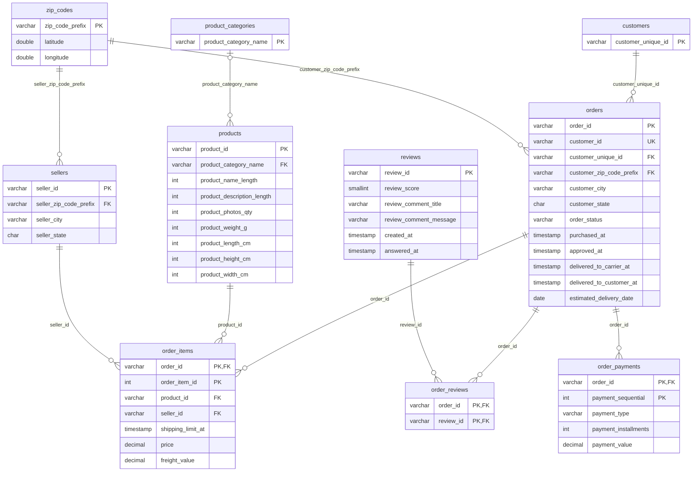

# Modelo normalizado

Gerado por `scripts/render_diagrams.py` a partir de [normalized.dbml](normalized.dbml). Não edite à mão: altere o `.dbml` e rode o script de novo.

Legenda: `PK` chave primária, `FK` chave estrangeira, `UK` valor único. `||--o{` = um para zero ou muitos; `|o--o{` = a chave estrangeira pode ser nula.

## Tabelas

| tabela | descrição |
|---|---|
| `customers` | Só a identidade do cliente. O endereço fica no pedido, porque 250 clientes compraram com mais de um CEP. |
| `orders` |  |
| `order_items` |  |
| `order_payments` |  |
| `reviews` | Uma avaliação pode cobrir mais de um pedido do mesmo cliente (789 casos, sempre com o mesmo conteúdo). |
| `order_reviews` | Tabela associativa: resolve a relação N:N entre pedidos e avaliações. |
| `products` |  |
| `product_categories` | Domínio das categorias, montado a partir dos produtos (inclui 2 categorias que faltam na tabela de tradução). |
| `sellers` |  |
| `zip_codes` | Uma linha por prefixo de CEP usado por clientes, vendedores ou pela geolocalização. Substitui a geolocalização bruta, que tem ~1 milhão de pontos e não pode ser ligada diretamente. |
